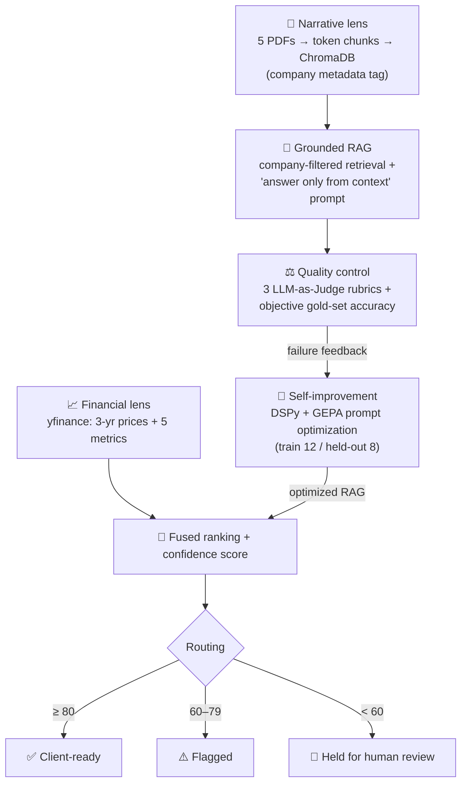
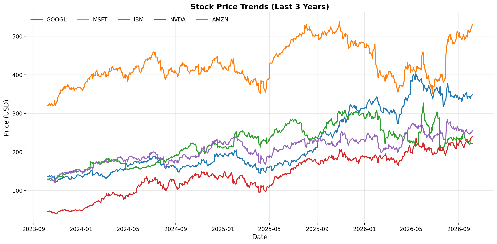

# DualLens Analytics — Trustworthy AI Investment Research

[](https://colab.research.google.com/github/sabasazad/duallens-analytics-rag/blob/main/DualLens_Analytics_RAG.ipynb)


A retrieval-augmented research assistant that combines **live market data** with **company AI-strategy documents** to rank five tech companies (GOOGL, MSFT, IBM, NVDA, AMZN) — and, unlike a plain chatbot, it **measures its own answer quality, optimizes its own prompt, and routes its final recommendation by confidence** so an untrusted answer never reaches a client.

> Built as **Project 1 of the Johns Hopkins University Certificate Program in Agentic AI** (Generative AI Foundations module). The program supplied the case study, data files and notebook scaffold; the implementation, prompts, diagnostics and analysis are my own.

---

## The problem

A (fictional) research firm piloted an LLM assistant that confidently described an NVIDIA project timeline **that didn't exist in any source document**. The audit found three recurring failures: answers attributed to the **wrong company**, **fabricated specifics**, and **no way to tell a reliable answer from an unreliable one**.

The goal of this project: produce answers you can **trust, measure, and improve**.

## Architecture



| Stage | What I built |
|---|---|
| **Financial lens** | 3-year price trends and a metrics table (Market Cap, P/E, Dividend Yield, Beta, Revenue) via `yfinance`, with per-metric comparison charts |
| **Narrative lens** | PDF ingestion with a `company` metadata tag on every page, `tiktoken`-based chunking (512 / 64 overlap), OpenAI embeddings in ChromaDB |
| **Grounded RAG** | A single `retrieve()` doorway with optional company filter, a strict grounding prompt with an *"I don't know."* guardrail, and a 5-query typed test suite including an out-of-scope trap |
| **Retrieval diagnostics** | An LLM-free check on a 20-question gold set: did the expected answer token even reach the retrieved chunks, with vs. without the company filter? |
| **LLM-as-Judge** | Groundedness, Context Relevance and Answer Relevance rubrics (1–5, machine-readable `Score: N`), a batch evaluation loop and a pass/fail table |
| **Prompt optimization** | A typed `dspy.Signature` + retrieval-aware `dspy.Module`, a deterministic GEPA metric with targeted feedback and an 80-word anti-keyword-stuffing guard, evaluated on held-out questions |
| **Decision layer** | A fused ranking prompt that must cite a financial metric *and* a named initiative for every rank, plus a weighted confidence score (40% gold accuracy / 30% judge mean / 30% ranking groundedness) that routes the output |

## Results



| Measurement | Result |
|---|---|
| Retrieval hit-rate (expected token in top-4 chunks) | **75%** with or without the company filter (100% right-company purity) |
| v1.0 baseline accuracy, full gold set | **6/20 (30%)** |
| Held-out accuracy, v1.0 → GEPA-optimized v2.0 | **1/8 (12%) → 4/8 (50%)** |
| Best score *any* prompt could reach on held-out set | 5/8 — the other 3 were retrieval misses |
| Final confidence score | **59.0 / 100 → 🛑 held for human review** (1 point below "flagged") |

### What I learned

- **Separating retrieval failures from generation failures explained everything.** The answer reached the context for 15/20 questions, yet v1.0 answered only 6 correctly — 8 of the 14 misses were over-cautious *"I don't know."* refusals with the answer sitting in the context. GEPA fixed exactly that class of error; the remaining misses need retrieval changes, not better prompts.
- **LLM judges couldn't tell a correct refusal from a wrong one.** The out-of-scope probe and an in-scope refusal received nearly identical scores. That's why the optimizer was driven by a free, deterministic substring metric instead of judge scores.
- **The optimizer optimizes whatever the metric and its feedback say.** Quoting the expected token in my feedback strings led GEPA to bake example product names into the prompt — a form of leakage I flagged in the analysis. The 80-word guard blocked the obvious exploit of listing every product name.
- **Loosening refusals traded one risk for another.** v2.0 fixed four refusals but turned one correct answer (IntelliCode) into a confident wrong one (GitHub Copilot).
- **Self-grading isn't enough.** The same `gpt-4o-mini` model gave its own ranking 4/5 for groundedness despite a false P/E comparison — which is why objective signals carry the most weight and borderline output goes to a human.

The notebook contains the full diagnostics, judge reasoning, evolved prompt and a written analysis for each stage.

## Tech stack

Python · LangChain · OpenAI (`gpt-4o-mini`, `text-embedding-3-small`) · ChromaDB · DSPy + GEPA · yfinance · pandas · matplotlib · scikit-learn

## Run it yourself

The notebook was built for **Google Colab**.

1. Click **Open in Colab** above.
2. Run the first cell to install dependencies, then **restart the runtime**.
3. Upload two files to `/content/`:
   - `config.json` — copy [`config.example.json`](config.example.json) and add your OpenAI API key
   - [`data/Project_Datafiles.zip`](data/Project_Datafiles.zip) — the five company PDFs and the gold dataset
4. Run the remaining cells. GEPA optimization takes ~5–15 minutes.

To run locally instead, `pip install -r requirements.txt` and change the `/content/...` paths in the notebook to point at `data/`.

> Results vary between runs: yfinance returns live prices and LLM outputs aren't fully deterministic.

## Repository structure

```
├── DualLens_Analytics_RAG.ipynb        # Full pipeline with outputs and analysis
├── data/
│   ├── Project_Datafiles.zip           # Archive the notebook unzips
│   ├── Companies-AI-Initiatives/       # Five company AI-strategy PDFs
│   └── golden_retrieval.csv            # 20 gold questions with verified answer tokens
├── assets/stock_price_trends.png
├── config.example.json                 # Template — real config.json is git-ignored
└── requirements.txt
```

## Next steps

- **Retrieval upgrades** — hybrid BM25 + embedding search, query rewriting and re-ranking (retrieval is now the bottleneck)
- **Stronger evaluation** — a 100+ question gold set, a separate GEPA validation set and a judge from a different model family
- **A verification agent** — check every number and comparison in the ranking against the data table in code
- **Fresh data at scale** — scheduled ingestion of filings and transcripts with dated chunks, beyond five companies

---

*Educational project — not investment advice.*
